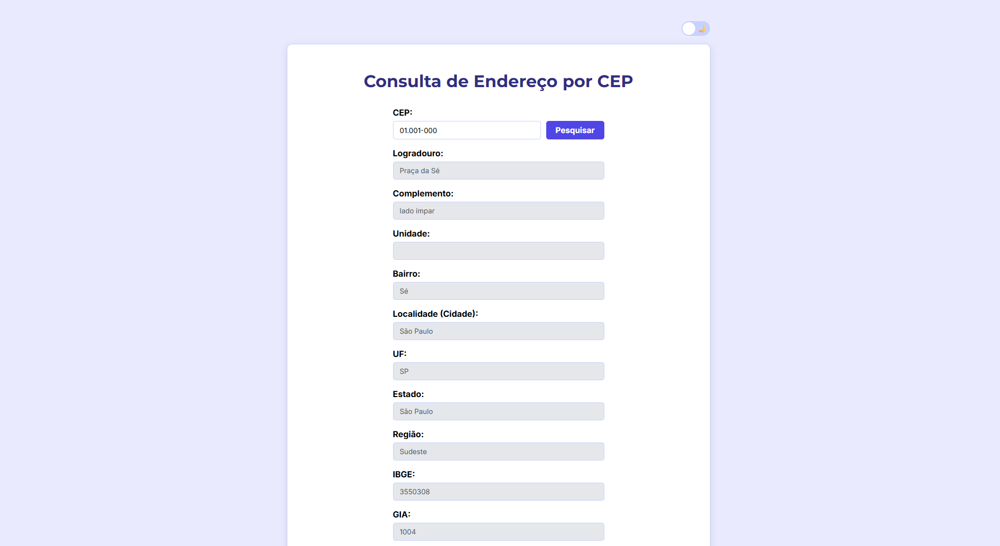
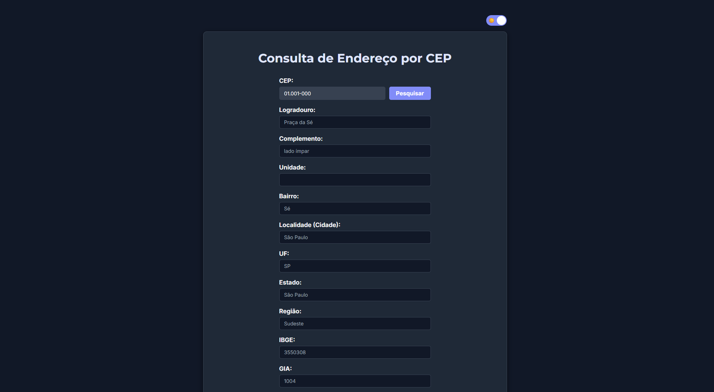

# 📍 BuscaCEP | Consulta de Endereços

Este projeto é uma aplicação web para consulta de endereços a partir do CEP. O usuário digita o CEP, clica em **Pesquisar** (ou aperta **Enter**) e todos os dados do endereço são preenchidos automaticamente, como logradouro, bairro, cidade, estado, região e códigos oficiais (IBGE, GIA, DDD e SIAFI).

Foi desenvolvido como prática de **JavaScript puro**, com foco em consumo de API, manipulação do DOM, validação de entrada e persistência de preferências do usuário.

---

## 🚀 Tecnologias e Conceitos Aplicados

O projeto foi construído com **HTML5, CSS3 e JavaScript puros**, sem frameworks ou bibliotecas externas. Os principais destaques são:

* **Consumo de API com `fetch` e `async/await`:** Os dados são buscados na API pública [ViaCEP](https://viacep.com.br/), com tratamento de erros via `try/catch` e verificação da propriedade `erro` retornada para CEPs inexistentes.
* **Máscara de CEP em tempo real:** A função `mascaraCep()` formata o texto enquanto o usuário digita (`00.000-000`), usando expressões regulares (RegEx) e limitando a entrada a 8 dígitos.
* **Bloqueio de caracteres inválidos:** O evento `keydown` impede a digitação de qualquer tecla que não seja número, preservando teclas de navegação (`Backspace`, `Delete`, setas, `Tab`, etc.) e atalhos como `Ctrl + V`.
* **Busca com a tecla Enter:** Além do botão, a consulta também pode ser disparada pelo teclado, melhorando a usabilidade.
* **Código organizado e reutilizável:** Uma constante (`CAMPOS_ENDERECO`) centraliza os campos do formulário, permitindo preencher e limpar todos eles com um único `forEach`.
* **Tema claro e escuro:** Alternância de tema por um *toggle switch* feito apenas com CSS e um checkbox, com a preferência salva no `localStorage` e restaurada ao reabrir a página.
* **Variáveis CSS (Custom Properties):** Toda a paleta de cores, fontes e sombras fica centralizada no `:root`, e o modo escuro apenas redefine essas variáveis em `body.dark-mode`.
* **Tipografia com Google Fonts:** Uso de *Montserrat* nos títulos e *Inter* no corpo do texto.
* **Layout responsivo:** O card se adapta a diferentes larguras de tela com `max-width`, `width: 100%` e Flexbox.
* **Transições suaves:** Animações em cores, bordas, foco dos campos e no botão de pesquisa (`transition` e `transform`).

---

## 🔎 Informações Retornadas

| Campo        | Descrição                          |
|--------------|------------------------------------|
| Logradouro   | Nome da rua, avenida, etc.         |
| Complemento  | Complemento do endereço            |
| Unidade      | Unidade, quando houver             |
| Bairro       | Bairro                             |
| Localidade   | Cidade                             |
| UF           | Sigla do estado                    |
| Estado       | Nome do estado                     |
| Região       | Região do país                     |
| IBGE         | Código do município no IBGE        |
| GIA          | Código GIA                         |
| DDD          | Código de área telefônica          |
| SIAFI        | Código do município no SIAFI       |

---

## ⚠️ Tratamento de Erros

* **CEP incompleto:** avisa que é necessário digitar 8 dígitos.
* **CEP inexistente:** informa que o CEP não foi encontrado.
* **Falha na requisição (ex.: sem internet):** exibe uma mensagem de erro.

Em todos os casos, os campos de resultado são limpos para evitar dados antigos na tela.

---

## 📂 Estrutura de Arquivos

* `index.html`: Estrutura da página, com o formulário de busca, os campos de resultado (somente leitura) e o botão de alternar tema.
* `style.css`: Estilização completa, incluindo variáveis de cor, tema escuro, layout e animações.
* `script.js`: Lógica da aplicação (máscara, validação, tema e consulta à API).

---

## 📖 Como visualizar o projeto?

👉 [Clique aqui para acessar o BuscaCEP](https://valdirneto34.github.io/Projeto-BuscaCEP/)

---

## 🛠️ Como rodar localmente?

1. Clone este repositório em sua máquina:
   ```bash
   git clone https://github.com/valdirneto34/Projeto-BuscaCEP
   ```
2. Abra o arquivo `index.html` no navegador. Não é necessário instalar nada, apenas ter conexão com a internet para acessar a API.

---

## 📸 Screenshots do Projeto
   <p align="center">
        <strong>☀️ Tema Claro</strong><br>
        
        
    </p>
   <p align="center">
        <strong>🌙 Tema Escuro</strong><br>
        
        
    </p>